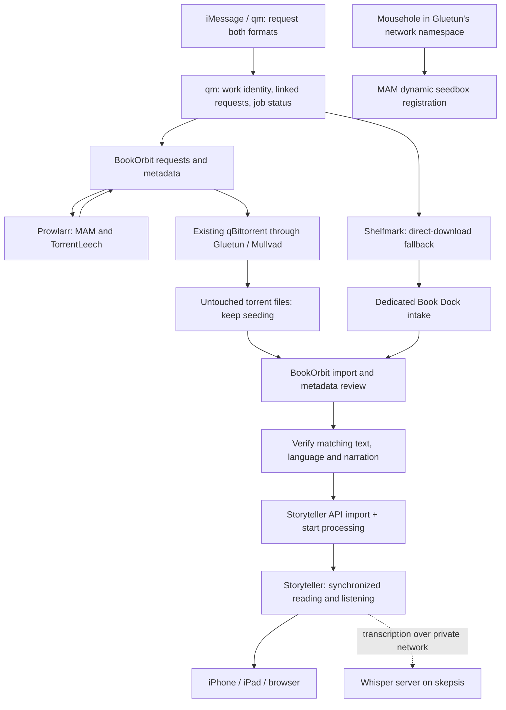

**Ebook stack evaluation, 20 September 2026.** Use Storyteller as the reading/listening system, BookOrbit as the catalog and metadata editor, BookOrbit's requests for indexed downloads, and the existing Shelfmark for direct downloads. Keep the existing qBittorrent/Gluetun pair. Replace the failing MAM updater with Mousehole and repair the account/session configuration. Extend qm to coordinate one logical request across both formats and Storyteller processing. Audiobookshelf is unnecessary for the stated iPhone/iPad/browser workflow.

Implementation update: see the [migration status](ebook-stack-migration.md) for the current skepsis deployment. This report records the setup before migration.

This is a proposed architecture, not a completed deployment. The investigation used read-only Docker inspection, application configuration, SQLite queries, file counts, HTTP checks, and qBittorrent API reads on both hosts. No application was upgraded, restarted, reconfigured, or asked to acquire a book. Account credentials and raw tracker URLs are excluded from this report.

**What is actually running.** SSH to chrysaora works from skepsis through its Tailscale address. Its short hostname did not resolve from this shell. You can perform the eventual work from this workspace using SSH; you do not need a separate interactive session on chrysaora.

| Component | Observed deployment on chrysaora | What it currently does / problem |
| --- | --- | --- |
| Storyteller | `web-v2.3.16`, running | Five database books, each with ebook, audiobook and an `ALIGNED` readaloud; none marked missing. No automatic import path configured. Uses CPU whisper.cpp with the `tiny` model. Logs contain repeated application/form errors; alignment quality and device playback were not tested. |
| BookLore + MariaDB | BookLore `v1.10.0`, running; internal HTTP 200 | Ebook manager, mounted at `/mnt/data/media/books`. BookDrop is under `/home/avirut/selfhosted/data/booklore/bookdrop`. |
| Shelfmark | Image label `1.3.0`, running and healthy | Already replaced Ephemera in the live Compose file. Direct downloading enabled; configured to upload to BookLore's BookDrop over HTTP. Prowlarr integration and user requests are disabled. |
| `readarr` | PennyDreadful Bookshelf fork, `hardcover-v0.4.20.91`, running | Audiobook root, 37 book records and seven imported book-file records; qBittorrent enabled. This is a fork, not stock Readarr. |
| Audiobookshelf | `2.30.0` image label, stopped for about seven months | Recorded failure refers to an overlay network that no longer exists. Configuration and media mounts remain. |
| qBittorrent | `5.2.0` image label, running inside Gluetun's network namespace | 83 torrents at inspection: 63 TV, 19 movies, one audiobook. The MAM torrent's stored tracker response says the account is parked. |
| Gluetun | Running and healthy, Mullvad WireGuard | Selection is by Amsterdam city, allowing the chosen exit to change. |
| `seedboxapi` | Crash-looping; 33,772 restarts at inspection | Persisted cookie file contains no `mam_id`. Last API response: `Success:false`, `Invalid session - Other`. Debug mode is enabled. |
| Prowlarr | `2.3.5.5327`, running | MAM and TorrentLeech configured. MAM has a failure/backoff record through September 21. Prowlarr has its own network namespace, separate from the VPN-routed downloader. |

The main library directories contain **271 EPUB files** (about 0.77 GB), **seven M4B files** (about 4.87 GB), and about **4.87 GB of Storyteller assets/cache**. These are file counts, not a claim that there are 271 distinct, correctly matched works. The existing Storyteller library is much smaller than the ebook catalog.

There is meaningful deployment drift: skepsis's tracked `apps/arr/docker-compose.yaml` still says Ephemera; chrysaora has an uncommitted replacement with Shelfmark and a different WireGuard address. Caddy's `ephemera.kroac.net` route already targets Shelfmark's port, 8084. Preserve and reconcile that live change before deploying from the checked-in file. Shelfmark currently has no torrent-download bind mount, so enabling Prowlarr alone would not complete its local torrent import setup.

Skepsis runs Caddy, Authentik, qm and its messaging worker, alongside the other personal applications. It runs none of these book services. The qm media commands currently support Sonarr/Radarr only. The iMessage guide records successful live exchanges and movie requesting; the worker is active. `Linger=no` remains an outstanding prerequisite for keeping the user service independent of login sessions.

Local configuration references: [arr Compose](/home/avirut/selfhosted/apps/arr/docker-compose.yaml), [Storyteller Compose](/home/avirut/selfhosted/apps/storyteller/docker-compose.yaml), [BookLore Compose](/home/avirut/selfhosted/apps/booklore/docker-compose.yaml), [Audiobookshelf Compose](/home/avirut/selfhosted/apps/audiobookshelf/docker-compose.yaml), [Caddy](/home/avirut/selfhosted/apps/caddy/Caddyfile), [qm media operations](/home/avirut/qm/src/lib/domains/media/README.md), [qm messaging status](/home/avirut/qm/docs/messaging.md). These local files do not include chrysaora's uncommitted changes.

**What each application can actually contribute.** Versions matter here: Storyteller's latest stable web release found was `web-v2.14.21`; BookOrbit's was `v2.10.0`; Shelfmark's was `v1.3.15`. Storyteller also has v3 test releases and separately versioned libraries; those are not substitutes for a stable server release. Release/source inspection is not a production compatibility test. [Storyteller stable release](https://gitlab.com/storyteller-platform/storyteller/-/releases/web-v2.14.21), [BookOrbit release](https://github.com/bookorbit/bookorbit/releases/tag/v2.10.0), [Shelfmark release](https://github.com/calibrain/shelfmark/releases/tag/v1.3.15).

| Application | Appropriate role | Important boundary |
| --- | --- | --- |
| Storyteller | Produce synchronized EPUB readalouds; serve the reading/listening library and progress | Does not acquire missing ebook/audio counterparts. Receiving two files is not proof their contents align correctly. |
| BookOrbit | Metadata, library administration, file organization and requests | Its two format requests do not establish a verified narration/text pair or run Storyteller. |
| Shelfmark | Direct-source search/download and optional torrent acquisition | Intentionally does not maintain a library inventory, monitor future availability, or provide the full persistent acquisition workflow. |
| Mousehole | Maintain MAM's dynamic seedbox IP registration | Cannot unpark an account, authorize a new ASN by itself, or eliminate MAM's update cooldown. |
| qm | Interpret requests; connect format-specific records and processing status | New book operations and durable background reconciliation must be implemented. Current movie commands do not already do this. |
| BookBridge | Optional existing tool for reviewing ebook/audio matches and submitting them to Storyteller | Adds another service; does not replace requesting or prove that two editions are equivalent. |
| Audiobookshelf | Optional audiobook/podcast server with its own client ecosystem | Not needed as a Storyteller dependency; its native ebook and audio positions are separate. |

Storyteller accepts EPUBs and supported audio files, including ebook-only and audio-only entries. It can combine the two into one book and generate an EPUB containing narration and timing information. Its iOS app supports offline downloads and synchronizes position when connected to the server. This matches the requested phone/tablet experience. [Book ingestion](https://storyteller-platform.dev/docs/managing/adding/), [mobile apps](https://storyteller-platform.dev/docs/reading/storyteller-apps/).

The browser experience is a material caveat: the web reader remains documented as **experimental**. The project recommends Chromium for the smoothest experience and does not promise offline reading through the PWA. The existing Compose already enables it. Test the actual browser alongside iOS before declaring the system dependable. Keep daily reading in Storyteller so progress has one owner. [Web reader](https://storyteller-platform.dev/docs/reading/web-reader/).

Storyteller v2.14 changed imports substantially: one book per folder is enforced, an arriving second format can join the existing book, and import rules support reference, copy, move and hardlink modes. Several older documentation sections explicitly warn that they are outdated. A folder watcher handles ingestion; the stable processing endpoint separately starts alignment. Do not design around a presumed “watch folder automatically aligns everything” behavior. [v2.14 import changes](https://storyteller-platform.dev/blog/20260525_scanner/), [processing endpoint at the stable tag](https://gitlab.com/storyteller-platform/storyteller/-/blob/web-v2.14.21/applications/web/src/app/api/v2/books/%5BbookId%5D/process/route.ts).

BookOrbit is a good match for metadata work: provider comparisons, per-field choices and locks, editable narrator/abridgement information, metadata completeness indicators, bulk table editing and file organization. Use conservative enrichment and lock corrected identifiers, language, author and series information. Keep narrator and edition identity rather than flattening everything into title/author. [Metadata settings](https://bookorbit.app/metadata/), [book editing](https://bookorbit.app/book-details/), [table view](https://bookorbit.app/table-view/).

BookOrbit requests are real, but still marked beta. They support metadata discovery, approval/self-service, Torznab sources such as Prowlarr, qBittorrent, automatic release selection and import review. One request covers one medium; wanting both means two requests. No acquisition-source plugins ship with it. Native Anna's Archive/LibGen support therefore must not be assumed. Keep Shelfmark for those sources unless a particular BookOrbit plugin is separately reviewed and tested. [BookOrbit requests](https://bookorbit.app/book-requests/).

Its backend exposes JWT-authenticated APIs and Swagger at `/api/docs` and `/api/docs-json`. Source confirms `/api/v1/book-requests`, request status/availability, administrative release search/grab, and adding files to an existing book. These provide a practical qm integration path; there is no need to automate clicks. Pin the version and verify response schemas when implementing. [API setup](https://github.com/bookorbit/bookorbit/blob/v2.10.0/server/src/swagger.ts), [request controller](https://github.com/bookorbit/bookorbit/blob/v2.10.0/server/src/modules/book-request/book-request.controller.ts), [administrative operations](https://github.com/bookorbit/bookorbit/blob/v2.10.0/server/src/modules/book-request/book-request-admin.controller.ts), [attach a file](https://github.com/bookorbit/bookorbit/blob/v2.10.0/server/src/modules/upload/book-file-upload.controller.ts).

There is a documentation discrepancy worth preserving: BookOrbit's website now describes Storyteller media-overlay playback and cross-format position translation. I could not corroborate that integration in the `v2.10.0` application source or the inspected September 18 main commit; the corresponding feature issue was still open. Vendored Foliate code has overlay primitives, which alone do not prove that BookOrbit exposes a complete supported workflow. Treat the website description as a release-verification item. It also describes using a generated file inside BookOrbit, not a verified connection to a Storyteller server's user progress. [Website claim](https://bookorbit.app/storyteller-read-aloud/), [feature issue](https://github.com/bookorbit/bookorbit/issues/1035), [stable application source](https://github.com/bookorbit/bookorbit/tree/v2.10.0/client/src/features/reader).

Shelfmark supports both media types, configured direct-source mirrors, Prowlarr, downloader clients, folder delivery and BookLore upload. Its own scope explicitly excludes library awareness and ongoing monitoring. It is useful here because it is already installed and provides the direct-download path BookOrbit does not bundle. Point it at a dedicated BookOrbit Book Dock directory after migration; do not assume its BookLore-specific upload adapter is compatible with BookOrbit. [Project scope](https://github.com/calibrain/shelfmark#project-scope), [output implementations](https://github.com/calibrain/shelfmark/tree/v1.3.15/shelfmark/download/outputs).

Shelfmark also has a completion script hook with a structured payload. Use it to record a completed transfer and enqueue follow-up work; alignment must run separately because the hook has a five-minute timeout. Polling must recover missed hooks. Direct-download success remains dependent on the configured source and its current access restrictions; a mirror setting cannot guarantee reliable acquisition. [Completion scripts](https://github.com/calibrain/shelfmark/blob/v1.3.15/docs/custom-scripts.md).

Audiobookshelf can be omitted. It has valuable audiobook metadata tools, chapter editing, merging and podcast support, but adding it would introduce another playback/progress system you have not asked for. Its own documentation explicitly says ebook and audiobook progress are tracked separately. Preserve its old data until deciding whether any listening history is worth migrating. [Features](https://audiobookshelf.org/docs/documentation/introduction/), [ebook limitations](https://audiobookshelf.org/docs/documentation/libraries/book-library/ebooks/).

**Other candidates worth considering.** BookBridge `v7.7.0` can take audio and ebooks from BookOrbit and upload them into Storyteller for processing. Its “Create Storyteller Edition Only” operation is particularly relevant: use that to test the transfer without introducing cross-app progress synchronization. I would use it for the first pilot before writing an uploader. It can remain as a match-review interface if useful; qm still needs to connect requests and trigger/reconcile jobs. Automatic unattended operation is not established just because its UI has a button. [Tagged BookBridge guide](https://github.com/cporcellijr/bookbridge/blob/v7.7.0/docs/user-guide.md#storyteller-editions).

ReadMeABook is the strongest alternative if automatic acquisition of a companion EPUB is the top priority. It already creates child ebook requests for completed audiobooks and can use Anna's Archive or Prowlarr. However, its documented library backends are Plex/Audiobookshelf, so selecting it would pull this design back toward a server you want to remove. It still does not guarantee edition agreement or Storyteller alignment. [Ebook companion workflow](https://github.com/kikootwo/ReadMeABook/blob/main/documentation/integrations/ebook-sidecar.md), [supported stack](https://github.com/kikootwo/ReadMeABook).

Shelfarr is a credible alternative acquisition layer with BookOrbit integration, direct downloads, per-indexer client routing and API tokens. It becomes more attractive if BookOrbit requests prove unreliable or if different trackers need different clients. I would trial it as a **replacement** for acquisition components at that point, rather than run multiple competing request queues now. Its published integration list does not establish native Storyteller alignment. [Shelfarr capabilities](https://github.com/Pedro-Revez-Silva/shelfarr).

Do not expand the old Readarr-based pipeline. Upstream Readarr has retired; the deployed Bookshelf fork is distinct, so this is not a claim that the fork is also retired. Its existing wanted list should be exported before retirement. Calibre remains useful as an occasional format-conversion tool, but another permanent metadata server is unnecessary. [Readarr announcement](https://github.com/Readarr/Readarr).

**How the recommended stack connects.** The proposed qm book integration below is new work. Existing native components cover acquisition, cataloging and alignment separately.



BookBridge can supply the verified-pair-to-Storyteller transfer step during the pilot. The alternative is a small qm worker using Storyteller's documented API, not a second ebook management application.

For a request such as “get this book with audio,” qm should:

1. Resolve the work and language; check existing BookOrbit and Storyteller entries before requesting anything. Use stable catalog IDs where possible. Ebook ISBN and audiobook ISBN/ASIN may legitimately differ.
2. Save one durable request with separate ebook and audiobook child IDs, selected editions and a later Storyteller UUID. Existing qm/PostgreSQL can own this coordination state; applications retain ownership of their own catalogs.
3. Request only missing formats. Prefer existing good files first, MAM for audio, TorrentLeech as an indexed fallback, and Shelfmark for accessible EPUB sources. If Shelfmark fulfills a BookOrbit request, close it against the actual imported book so another downloader does not also fulfill it.
4. Track downloads, failed imports, missing counterparts and retries. A permanent worker/timer handles completion; an iMessage conversation should not have to stay open for hours.
5. Check language, author, translation, abridgement, narrator/edition preference, chapter coverage and ordered audio tracks. Reject dramatizations or materially different editions for ordinary alignment. Use AI to interpret ambiguous metadata; require concrete file/identifier evidence before accepting a pair.
6. Import the verified pair into one Storyteller entry, trigger processing once and poll its result. Reconcile an interrupted operation before retrying so a lost HTTP response cannot create duplicate books or repeated jobs.
7. Report honest status: waiting for ebook, waiting for audio, review needed, aligning, or ready in Storyteller. “Downloaded” and “aligned” are different milestones. Notify only for completion or a problem requiring action.

BookOrbit web requests can use the same default-both policy through reconciliation: detect a newly created request and create/link the missing counterpart. Make ebook-only/audio-only requests explicit exceptions. This policy is proposed qm functionality, not a current BookOrbit setting.

**Clean metadata and safe files.** BookOrbit should own source metadata; Storyteller should own reading position and generated readaloud assets. Metadata corrections should flow one way to Storyteller through the integration. Cosmetic metadata updates should not recreate reading records. Changes to text content or audio edition require deliberate re-alignment and preservation of existing progress/history.

Use a clean per-book directory layout in each source library. Initially, separate ebook and audiobook libraries are acceptable and preserve edition-specific identifiers. A pair can refer to two catalog records. BookOrbit can also group multiple formats or attach a file to an existing entry, but two independent requests should not be assumed to merge themselves into one record. The current Readarr audio layout sometimes puts multiple books directly under an author/series folder; restructure a copied pilot first, since folder-as-book scanners can group that incorrectly. [BookOrbit library structure](https://bookorbit.app/library-file-structure/), [library configuration](https://bookorbit.app/creating-a-library/).

Suggested paths on chrysaora:

```text
/mnt/data/torrents/                    Existing torrent payloads; downloader owns these
/mnt/data/book-intake/bookorbit/       Separate Book Dock intake
/mnt/data/media/books/                 Curated source ebooks
/mnt/data/media/audiobooks/            Curated source audiobooks
/mnt/data/book-intake/storyteller/     Optional staging, one verified pair per folder
/mnt/data/media/storyteller/           Storyteller-owned assets and generated readalouds
```

For this library, start with **copies** from torrent payloads into editable catalogs and separate Storyteller copies/uploads. There is ample free media storage, and this eliminates shared-file mutation as a failure mode. Preserve the torrent files, names and qBittorrent state for seeding.

Hardlinks can be introduced later after validating every writer. They share file contents, so a generic in-place editor can damage a seeded payload. BookOrbit's inspected format writers use temporary files and atomic replacement, which separates the edited copy, but that behavior must not be assumed for every tool or Storyteller operation. Folder renames also invalidate paths held by another application. [BookOrbit replacement implementation](https://github.com/bookorbit/bookorbit/blob/v2.10.0/server/src/modules/file-write/formats/shared/atomic-file-replace.ts), [Storyteller source-file behavior](https://storyteller-platform.dev/docs/managing/adding/).

If using hardlinks, the importing container must see source and destination on the same filesystem through compatible mounts. Put Book Dock under `/mnt/data`, expose the needed common parent to the importer, and use matching downloader paths/path mappings. Verify link creation rather than relying on the host's directory names. Keep downloader administration and library writers separately scoped.

**Fixing MAM without another torrent client.** The evidence shows three distinct failures, not simply a boot-order problem:

- qBittorrent's stored MAM tracker message says: “Error, your account is parked! Please unpark to use the tracker!” This needs verification and correction in MAM's account preferences.
- The updater receives `Invalid session - Other`, and its persisted cookie jar contains no usable session. The response does not identify the original reason the session became invalid.
- Prowlarr's MAM indexer is failing/backing off. Its search session is a separate concern from qBittorrent's tracker traffic.

The cookie file is a persisted API session, not a way to make IP rules disappear. MAM supports dynamic seedbox registration. Mousehole's setup guide calls for an ASN-locked API session with permission to set the dynamic seedbox IP; it explicitly supports sharing Gluetun's network namespace with an existing qBittorrent. A fixed public IP is therefore not an absolute prerequisite. [Session setup](https://github.com/t-mart/mousehole/blob/v0.5.0/docs/getting-your-cookie.md), [Gluetun/qBittorrent example](https://github.com/t-mart/mousehole/blob/v0.5.0/docs/docker-compose-examples/gluetun-qb.md).

Recommended repair:

1. Confirm/unpark the MAM account and verify its present permissions and tracker requirements in the authenticated account UI.
2. Replace the current updater with pinned Mousehole `v0.5.0` or a subsequently reviewed release. Persist `/var/lib/mousehole`, configure its authentication, keep access private, and disable the old updater once the replacement works. Its current debug logging expands the cookie into logs, so remove that logging as part of the credential repair.
3. Create a dedicated updater session using the VPN exit IP that Mousehole actually reports. Permit dynamic seedbox updates and the appropriate ASN(s). Persist the rotated session state rather than restoring an obsolete bootstrap cookie on each restart.
4. Keep a separate Prowlarr session matched to **Prowlarr's actual outbound connection**. It currently does not exit through Gluetun. There is no need to move the entire movie/TV indexer service into the VPN merely to make its cookie match the downloader.
5. Prefer a specific stable Mullvad exit selection over city-wide rotation. That reduces changes but is not a contractual static-IP guarantee. Deliberate failover must account for session ASN permissions and the update cooldown.
6. Give every namespace-sharing service a healthy-Gluetun dependency. On a Gluetun replacement, recreate/reconcile all dependents together: qBittorrent, SABnzbd, Shelfmark and the updater. Docker Compose startup dependencies alone do not supervise every runtime VPN failure or engine reboot.
7. Monitor actual successful registration and tracker announces. Mousehole `/health` can return HTTP 200 while MAM rejects the session; inspect the response's `lastMamContactResult` and authenticated state. Pause new MAM acquisitions on failure and alert with the actual reason, without disrupting unrelated movie/TV torrents.

MAM's update constraints cannot be repaired with faster polling: Mousehole documents an account-wide one-hour interval between seedbox IP updates and explicit ASN approval when an exit changes networks. Keep one active updater for this seedbox path and handle throttling as waiting, not an invalid-cookie restart loop. Confirm these rules in the account UI during implementation; the authenticated MAM documentation was not accessible in this audit. [MAM error handling](https://github.com/t-mart/mousehole/blob/v0.5.0/docs/mam-errors.md), [health semantics](https://github.com/t-mart/mousehole/blob/v0.5.0/docs/API.md), [Compose dependency behavior](https://docs.docker.com/compose/how-tos/startup-order/).

There is a separate seeding limitation: **Mullvad does not provide port forwarding**. Publishing port 17426 in Docker does not forward that port through the VPN provider. Torrenting can still function through outbound peer connections, but peer reachability is reduced. If good long-term connectability becomes necessary, evaluate a provider with forwarding or a stable seedbox; that is a separate infrastructure choice, not a reason to duplicate qBittorrent immediately. Preserve each tracker's actual seeding obligations and avoid generic automatic deletion rules. [Mullvad's port-forwarding removal](https://mullvad.net/en/blog/removing-the-support-for-forwarded-ports).

**Placement and capacity.** Chrysaora has an i5-10400T, 7.5 GiB RAM, about 2.9 GiB available at inspection, and 2.3 GiB swap in use. `/mnt/data` is a roughly 17 TiB filesystem with 11 TiB free. Skepsis has the same CPU model but 15 GiB RAM and about 8.5 GiB available; it does not mount `/mnt/data`.

Keep downloads, BookOrbit and Storyteller assets on chrysaora. BookOrbit needs its own PostgreSQL database; the existing BookLore MariaDB is migration input, not a database it can reuse directly. Reclaiming the old services after migration helps, but do not pile unrestricted transcription on this already busy 8 GB host. [BookOrbit deployment](https://github.com/bookorbit/bookorbit/blob/v2.10.0/docker-compose.yml).

I would initially offload transcription to a bounded whisper.cpp server on skepsis using Storyteller's supported remote-transcription option. This sends audio to the worker and keeps the library local to chrysaora; no shared SQLite database or cross-host filesystem mount is required. Start with one processing job, measure memory and timing, and set limits that protect qm and the other applications. Remote transcription does not eliminate Storyteller's remaining alignment/transcoding costs. [Remote transcription](https://storyteller-platform.dev/docs/tutorials/offloading-transcription/).

Storyteller documents an 8 GB memory baseline for local processing. The existing `tiny` model is a useful starting measurement, not evidence of dependable timing. Compare a representative sample with a larger model, assess opening/middle/ending chapter alignment, and prefer accuracy over aggressive parallel/turbo settings. GPU acceleration is optional; none was validated in this audit. [Resource requirements](https://storyteller-platform.dev/docs/installation/resources/), [alignment tradeoffs](https://storyteller-platform.dev/docs/managing/aligning/).

**Migration order and acceptance criteria.**

1. Reconcile the two repository copies without losing chrysaora's changes. Back up BookLore/MariaDB, Storyteller's database and assets, Readarr's wanted list, qBittorrent state, old Audiobookshelf data and private credentials. Use database-aware backups, including SQLite WAL state; copying just a live `.db` file is insufficient.
2. Repair MAM independently of the library migration. Confirm search, torrent-file retrieval and a successful tracker announce. Check behavior after a planned dependent-container recreation, a host reboot, and a controlled VPN reconnect; schedule those tests around the active movie/TV stack.
3. Upgrade a backed-up Storyteller copy to the selected stable release. Preserve the five existing book UUIDs and reading positions. Test an already aligned book on iPhone, iPad and the actual browser, including offline progress returning online.
4. Deploy BookOrbit with a copied subset. Scan files before metadata migration, then dry-run the BookLore importer. Its documented tested BookLore source is v2.2.2, while this installation is v1.10.0: compatibility is **unverified**. Test against a disposable database copy and use an intermediate upgrade only if required. Do not promise a direct database migration will work. [Migration guide](https://bookorbit.app/migration/).
5. Pilot a handful of representative cases: a clean EPUB/M4B pair, multiple audio tracks, a translated or mismatched edition, an ebook without available audio, and a seeded book whose metadata is edited. Test BookBridge's edition-only transfer and evaluate whether it earns a permanent place.
6. Implement qm's book request/status operations and durable reconciliation. Configure BookOrbit's indexed requests and Shelfmark's dedicated direct-download intake. Verify the actual iMessage-to-download-to-alignment path, not just isolated successful API calls. Enable user lingering for the existing messaging worker.
7. Migrate the remaining library and review exceptions. Stop BookLore/MariaDB and the Bookshelf fork only after metadata, wanted books and file ownership have been accounted for. Preserve old backups. Audiobookshelf can remain stopped throughout.

The rollout is successful when one owner request gets the correct missing formats, leaves a visible reason when one cannot be found, preserves torrent seeding through metadata changes, survives restarting/recreating the VPN group, creates exactly one intended Storyteller book, and resumes at the correct text/audio position across the requested devices. None of those end-to-end claims should be inferred from a green container icon.

Remaining uncertainties are explicitly bounded: current MAM account settings require authenticated review; BookLore v1.10 migration needs a dry run; native BookOrbit read-aloud claims need a matching released implementation; external HTTP probes returned 403 from this environment and did not validate public client access; and actual iOS/browser playback, source acquisition and alignment performance were not exercised. These are pilot checks, not reasons to retain unnecessary servers.
